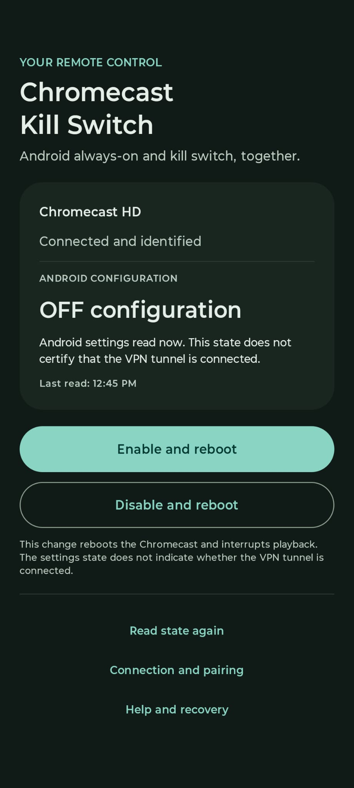

# Chromecast Kill Switch

A local Android remote for **Chromecast with Google TV HD**: enable or disable Android's always-on VPN and lockdown together for Proton VPN, verify the saved settings, and restart the Chromecast after confirmation. The app checks configuration; it does not continuously monitor the VPN tunnel or certify leak protection.

  

## Download and use

[Download the latest release](https://github.com/sorguido/chromecast-killswitch-app/releases/latest). Download the signed APK and `SHA256SUMS` from the same release. Open the APK on your phone and allow installation from that source if Android asks. Releases follow the repository's access permissions.

1. Connect the phone and Chromecast to a trusted local network. On the TV, open **Settings → System → Developer options → Wireless debugging → Pair device with pairing code**.
2. In the app, choose **Pair the Chromecast**, select the discovered service or enter the pairing IP address and port, then enter the code shown on the TV. The phone has its own ADB identity; no PC is needed.
3. Return to the TV's main Wireless debugging screen. Select its connection service in the app, or enter the connection port. This is different from the pairing port.
4. Choose **Enable and reboot** or **Disable and reboot**, read the confirmation, and confirm. Restarting interrupts playback. The app verifies the saved settings and reads them again after startup.

The app uses **Italian when the phone's primary system language is Italian**, including regional variants, and **English for every other primary system language**.

ON enables Android's always-on and lockdown settings for Proton. OFF removes both; Proton's own Auto-connect preference remains separate and can still start the VPN.

## Support and recovery

The supported TV configuration is **Chromecast with Google TV HD (`boreal`), Android 14/API 34, primary Android user `0`, and Proton VPN (`ch.protonvpn.android`)**. Other TV models, firmware versions and VPN providers are outside this project's scope.

The declared phone minimum is **Android 8/API 26**

If the connection does not return, re-enable Wireless debugging **on the TV**, then use **Read state again** or enter the current connection endpoint. The app cannot enable a disabled ADB service remotely and does not automatically repeat uncertain writes or restarts. Its help is available offline. USB debugging already enabled and a previously authorized PC provide a possible [USB recovery route](docs/COMMAND_CONTRACT.md#usb-recovery).

Use only a **trusted LAN** and never expose ADB to the Internet. The upstream client does not strongly authenticate the TLS server against an active network attacker; saved identity checks reduce accidental targeting but do not remove that limitation. See the [technical contract](docs/COMMAND_CONTRACT.md).

## Source and license

[Build and signing instructions](docs/BUILD.md) · [Product requirements](docs/PRODUCT_SPEC.md) · [Third-party notices](THIRD_PARTY_NOTICES.md) · [Development entry point](START.md)

Copyright © 2026 sorguido. The original app code is licensed under the **GNU General Public License, version 3 or any later version** (`GPL-3.0-or-later`); see [LICENSE](LICENSE) and the narrow [Conscrypt/BoringSSL linking permission](LICENSE-ADDITIONAL-PERMISSION). Third-party components retain their own licenses and notices. Release distributions include matching source and the material needed to rebuild with your own signing key.

This independent project is not affiliated with Google, Motorola or Proton.
